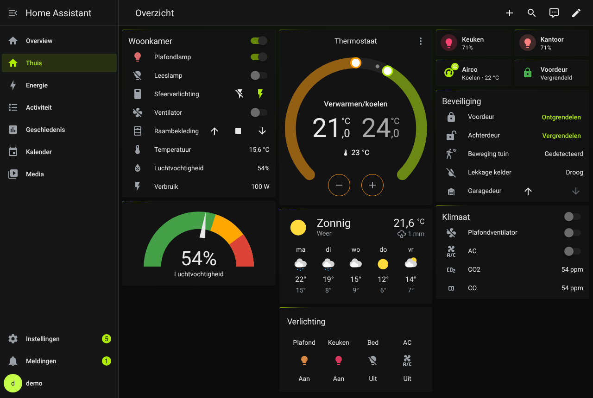
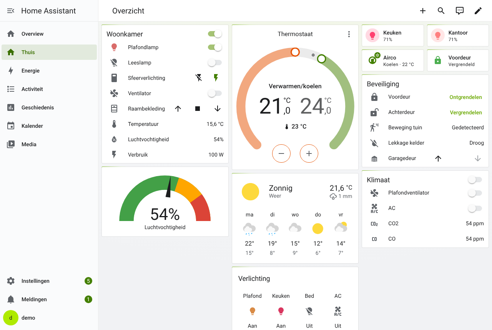
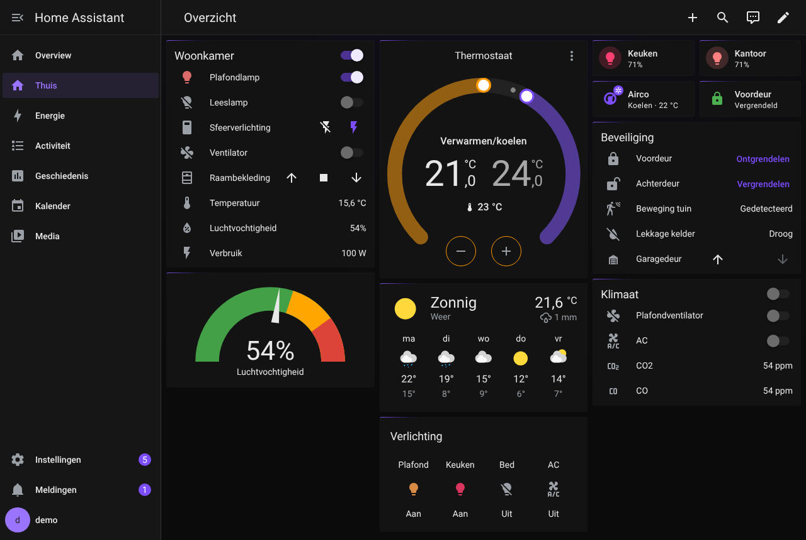
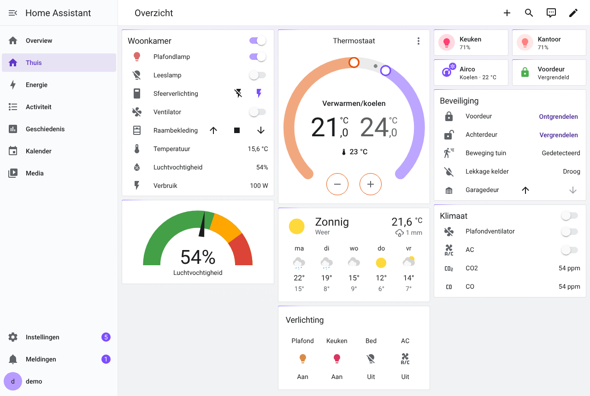
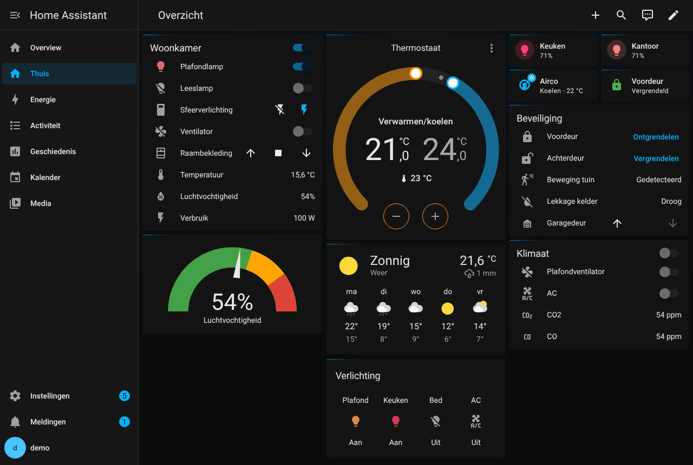
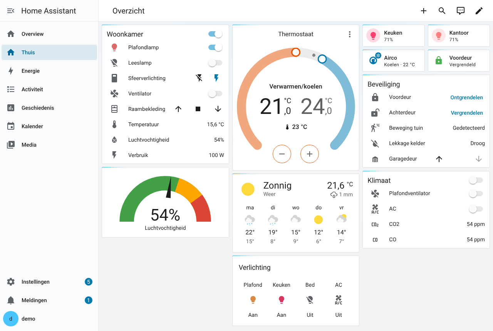

# Compact Gradient Themes

[](https://hacs.xyz/)
[](https://github.com/rvdlinden/HA-Themes/actions/workflows/validate.yml)

Drie compacte Home Assistant-themes met een platte, matte kaartstijl en een
subtiele gradient-glow linksboven op de kaartrand. Elk theme heeft een
**lichte en een donkere modus**: kies in je profiel bij *Themamodus* voor
Automatisch, Licht of Donker.

| Theme | Hoofdkleur (donker / licht) | Secundair accent |
|---|---|---|
| **Compact Lime Gradient** | `#aeea00` / `#437f00` lime | indigo |
| **Compact Violet Gradient** | `#7c4dff` violet | cyaan |
| **Compact Electric Blue Gradient** | `#00b0ff` / `#0079af` electric blue | magenta |

## Screenshots

### Compact Lime Gradient

| Donker | Licht |
|---|---|
|  |  |

### Compact Violet Gradient

| Donker | Licht |
|---|---|
|  |  |

### Compact Electric Blue Gradient

| Donker | Licht |
|---|---|
|  |  |

## Kenmerken

- Lichte en donkere modus per theme; *Automatisch* volgt de instelling van je
  apparaat.
- Radiale gradient op het dashboard-canvas (`lovelace-background`); sidebar en
  dialogen blijven vlak.
- Platte, matte kaarten (radius 3px, geen schaduw) met een gradient-rand.
- Volledig gethemede invoervelden, dropdowns, kaart-/YAML-editor en dialogen.
- Kleurpalet voor HA 2025.8+ (`ha-color-primary-*`) en grafiekkleuren.
- Afgestemde syntax-highlighting per theme en modus.
- In de lichte modus haalt tekst in de accentkleur minimaal 4.5:1 contrast.
- Compacte rijen (32px) en compactere kaart-padding via card-mod.

## Vereisten

- Home Assistant **2025.8** of nieuwer (voor het nieuwe kleurpalet; oudere
  versies werken grotendeels, maar negeren die variabelen).
- [card-mod](https://github.com/thomasloven/lovelace-card-mod) (via HACS) voor
  de compacte rijen en de kaart-styling. Zonder card-mod werken de kleuren wel,
  maar niet de compacte layout.

## Installatie

### Via HACS (aanbevolen)

1. Open HACS in Home Assistant.
2. Menu (⋮) → **Custom repositories**.
3. Voeg `https://github.com/rvdlinden/HA-Themes` toe met type **Theme**.
4. Zoek **Compact Gradient Themes** en klik op **Download**.
5. Zorg dat themes geladen worden in `configuration.yaml`:

   ```yaml
   frontend:
     themes: !include_dir_merge_named themes
   ```

6. Herstart Home Assistant (of roep de actie `frontend.reload_themes` aan).
7. Kies het theme via **Profiel** → **Thema** en daarna de **Themamodus**.

### Handmatig

Kopieer `themes/compact-dark-gradient.yaml` naar de map `themes/` in je
Home Assistant-configuratie en volg daarna stap 5 t/m 7 hierboven.

## Upgraden vanaf 1.x

In 2.0 zijn de themes hernoemd, omdat ze nu zowel licht als donker zijn:

| 1.x | 2.0 |
|---|---|
| Compact Dark Lime Gradient | Compact Lime Gradient |
| Compact Dark Violet Gradient | Compact Violet Gradient |
| Compact Dark Electric Blue Gradient | Compact Electric Blue Gradient |

Selecteer na het updaten het theme opnieuw in je profiel. Gebruik je de oude
naam in automatiseringen of in `frontend.set_theme`, pas die dan ook aan.

## Aanpassen

Elk theme bestaat uit een gedeeld deel (compacte layout en card-mod) en per
modus een blok onder `modes: dark:` en `modes: light:`. De kaartrand-glow en
afronding zijn per modus af te stellen in `ha-card-background` en
`ha-card-border-radius`; de commentaarblokken in het YAML-bestand beschrijven
welke waarden je waarvoor aanpast.

> **Let op:** `card-mod-theme` moet exact gelijk zijn aan de themanaam.
> Hernoem je een theme, pas dan ook die waarde aan, anders wordt de
> card-mod-styling niet toegepast.

## Licentie

[MIT](LICENSE)
